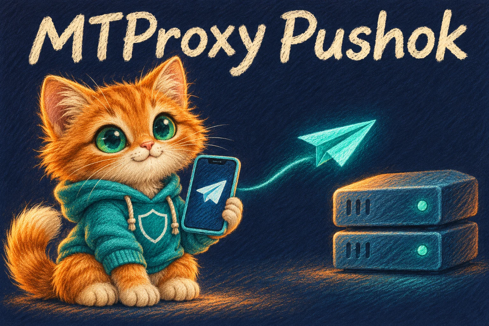

<div align="center">

# MTProxy Pushok

**Чистый трафик. Умная модерация. Прозрачный результат.**

Telegram MTProxy · ИИ-помощник · Спонсорские кампании · Mini App

[Установка](docs/INSTALL_QUICKSTART.md) · [Чистый трафик](#чистый-трафик) · [ИИ](#ии-в-pushok) · [Возможности](#возможности-проекта) · [Изменения](CHANGELOG.md)

[](https://github.com/mrkoster1988/mtproxy-pushok/actions/workflows/check.yml)

<p></p>

[Подключить трафик](https://t.me/mtproxy_pushok_bot) · [Канал проекта](https://t.me/pushok_proxy)

</div>

MTProxy Pushok — платформа для подключения Telegram-аудитории к каналам через спонсорские размещения в MTProxy. В одном кабинете собраны проверка каналов, ИИ-модерация, тарифы, оплата, расписание, управление прокси и отчёты. Владелец управляет системой на своём VPS, рекламодатель работает через Telegram-бота и Mini App.

Проект входит в экосистему Pushok VPN и устанавливается самостоятельно. Для работы кабинета не требуется отдельный магазин VPN.

Версия проекта: v1.123.

[Что изменилось в v1.123](docs/RELEASE_v1.123.md) · [Инвентаризация реализации и проверок](docs/PROJECT_INVENTORY.md)

[Возвраты оплаты v1.89](docs/RELEASE_v1.89.md).

## Чистый трафик

Наш акцент — заинтересованная аудитория, проверка рекламируемых каналов и понятный учёт результата. Проект не генерирует искусственные подписки и не продаёт нарисованные счётчики.

- **Проверка канала:** публичность, права рекламодателя, тематика и модерация перед размещением.
- **Выбор по интересам:** пользователь может добровольно выбрать тему; готовый общий вход направляет новые подключения на подходящие доступные узлы.
- **Прозрачные метрики:** охват ссылки, переходы и подписки считаются раздельно. Повторные события одного посетителя или подписчика не увеличивают соответствующий уникальный счётчик; Telegram-боты исключаются из событий подписки.
- **Контроль размещения:** история решений, этапы кампании и ответы агента доступны для проверки.

«Чистый трафик» — принцип работы и контроля качества, а не гарантия отсутствия любого бота. Учёт браузерного посетителя не доказывает уникальность человека. Статистика относится к отслеживаемой ссылке: она не измеряет все показы спонсора в Telegram и не гарантирует число новых подписчиков. Создание дополнительных прокси само по себе не создаёт аудиторию.

[Учёт переходов и подписок](docs/RELEASE_v1.48.md) · [Единый вход и интересы](docs/PROXY_GATEWAY.md)

## ИИ в Pushok

ИИ помогает проверять каналы и разбирать заявки, а сохранённое объяснение делает решение понятным сотруднику.

| Возможность | Как работает |
|---|---|
| Тематика канала | Подсказка по доступным сведениям, включая признаки контента 18+; тему можно уточнить вручную |
| Модерация | Одобрение подходящих каналов и отказ нерекомендуемым с причиной и уведомлением рекламодателю; сомнения и неполные данные направляются сотруднику |
| Разбор заявки | Сохранённый анализ, причины решения и помощь при подготовке ответа |
| Профиль «Агент ИИ» | Статистика решений, уникальных кампаний и тематик по журналу; ручные решения не приписываются ИИ |
| Контроль владельца | Настройка подключения и автоматики в блоке управления, возможность ручной проверки |

ИИ оценивает доступные сведения, а не весь скрытый контент канала и не личные переписки пользователей прокси. Фоновая модерация одобряет понятные каналы и отклоняет нерекомендуемые при подтверждённых признаках в публичных текстах. Рекламодатель получает описание канала, причину отказа и подпись «С уважением, Агент ИИ». Недостаток данных остаётся сотруднику; сбой ИИ приводит к повтору проверки. Возможность включается владельцем; ручной разбор по кнопке сам по себе решения не отправляет. Внешние сайты по ссылкам не просматриваются.

[Подключение ИИ](docs/RELEASE_v1.61.md) · [Тематика 18+](docs/RELEASE_v1.64.md) · [Профиль и статистика агента](docs/RELEASE_v1.83.md)

## Возможности проекта

- **Кампании:** канал, тематика, платные и бесплатные тарифы, период, очередь и единые карточки статусов.
- **Автоматизация:** подбор свободного слота, применение и переключение спонсорского тега агентом, диагностика и подготовка дополнительных прокси.
- **Платежи:** Telegram Stars, СБП в веб-кабинете, рублёвый баланс, бонусы, промокоды и подарки. Подтверждение платежа выполняется сервером с защитой от повторной обработки.
- **Управление:** роли рекламодателя, оператора и администратора, пользователи, узлы, история и документы, резервные копии и обновления.
- **Telegram:** бот с кнопкой «Подключить трафик», Mini App и вход через Telegram.

Тариф «1 день — 300 ₽» — исходный пример: стоимость и длительность настраиваются владельцем. Настоящие платежи, подключение Telegram и фактический показ спонсора проверяются на конкретной установке. Успешная сборка или применение тега не подтверждают показ в Telegram-клиенте.

## Установка из закрытого репозитория

Ubuntu 24.04 LTS, отдельный VPS и доступ к репозиторию. Используется опубликованная ветка `release/stable`.

Подготовьте GitHub fine-grained token **только для `mtproxy-pushok`**: `Contents: Read-only`, `Actions: Read-only` и автоматически добавляемое чтение Metadata. Токен вводится в SSH-терминале скрыто. Не вставляйте его в команду, ссылку или переписку.

После `sudo -i` выполните:

```bash
bash -c 'set -e; test "$(id -u)" -eq 0 || { echo "Сначала sudo -i"; exit 1; }; test ! -e /opt/mtproxy-pushok || { echo "Каталог уже существует: используйте инструкцию обновления"; exit 1; }; apt-get update; apt-get -o DPkg::Lock::Timeout=600 install -y git ca-certificates python3 util-linux; git -c credential.helper= -c credential.username=x-access-token clone --branch release/stable --single-branch https://github.com/mrkoster1988/mtproxy-pushok.git /opt/mtproxy-pushok; cd /opt/mtproxy-pushok; bash setup.sh --repository-access; exec bash setup.sh'
```

Git попросит токен в поле `Password` для первого скачивания. Затем мастер попросит его ещё раз для сохранения доступа к будущим обновлениям. Пароль GitHub здесь не используется. Мастер предложит прокси, кабинет или оба компонента и проверит запуск. Существующий каталог команда не перезаписывает.

Для уже установленного VPS — [переход на закрытый доступ](docs/PRIVATE_REPOSITORY.md). После однократной настройки продолжают работать «Версия и обновления» в кабинете и служба обновления.

`install.sh` устанавливает только классический MTProxy и запускается из полученной копии проекта. Анонимные команды через `raw.githubusercontent.com` для закрытого репозитория не подходят.

[Полная инструкция и ответы мастера](docs/INSTALL_QUICKSTART.md) · [Восстановление после ошибки](docs/INSTALL_RECOVERY.md)

## Доступ к исходникам

Приватное размещение GitHub ограничивает доступ к репозиторию его владельцем и приглашёнными участниками. На VPS код необходим для работы приложения и доступен администратору сервера. Изменение видимости не удаляет ранее скачанные копии. Лицензии и уведомления сторонних компонентов сохранены в `third_party` и `api/web/vendor`.

## Документация и проверки

- [Настройка спонсорского показа](docs/MTProxy_SPONSOR.md) · [Аккаунт владельца Telegram](docs/TELEGRAM_OWNER.md).
- [Stars и СБП](docs/PAYMENTS_STARS_SBP.md) · [Акции и кошелёк](docs/PROMOTIONS_AND_WALLET.md).
- [Mini App](docs/MINIAPP.md) · [Telegram-бот](docs/BOT_START.md).
- [Резервные копии](docs/CABINET_BACKUP.md) · [Предпусковая проверка](docs/STAGING_PREFLIGHT.md).
- [План развития](docs/ROADMAP.md) · [Журнал изменений](CHANGELOG.md) · [Критерии приёмки](docs/MVP_RELEASE_GATE.md).

GitHub Actions проверяет API/PostgreSQL, Docker, Rust и браузерные сценарии. Автотесты и демонстрационные снимки не заменяют приёмку живого Telegram, оплаты и спонсорского показа. Изображение выше — фирменная иллюстрация.
