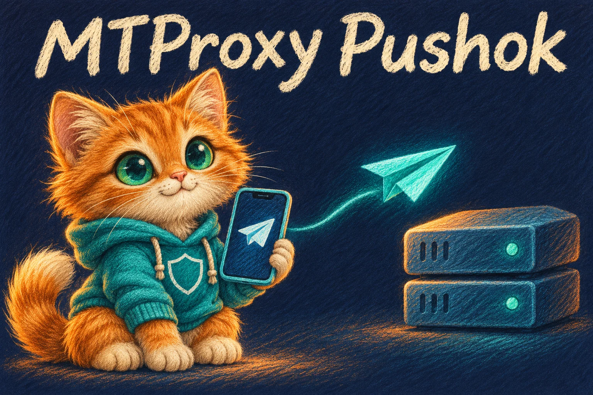
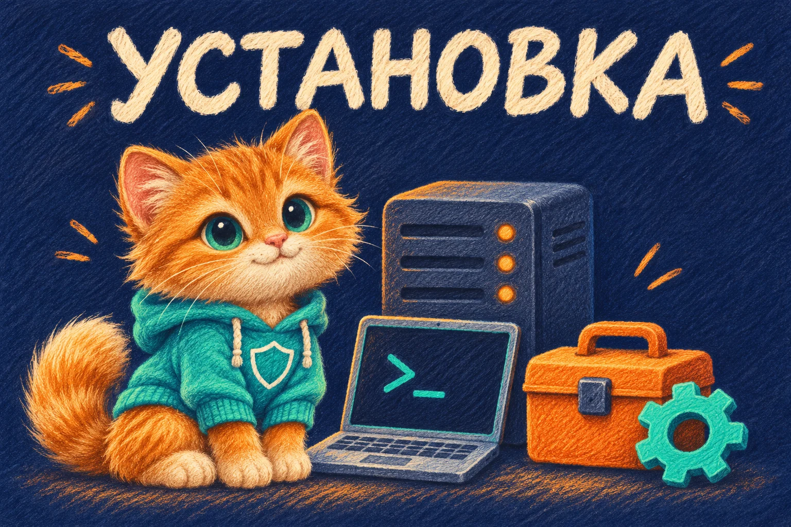

<div align="center">

# MTProxy Pushok

**Ваш прокси. Ваш канал. Ваше сообщество.**

MTProxy · Спонсорские каналы · Рекламный кабинет · Telegram-бот · Mini App

[Установка](docs/INSTALL_QUICKSTART.md) · [Возможности](#возможности-проекта) · [Спонсорство](docs/MTProxy_SPONSOR.md) · [План развития](docs/ROADMAP.md) · [Изменения](CHANGELOG.md)

[](https://github.com/mrkoster1988/mtproxy-pushok/actions/workflows/check.yml)
[](https://github.com/mrkoster1988/mtproxy-pushok/actions/workflows/pushok-icons.yml)

<p>
  <a href="docs/INSTALL_QUICKSTART.md"></a>
</p>

[Канал проекта](https://t.me/pushok_proxy) · [Telegram-бот](https://t.me/mtproxy_pushok_bot)

</div>

MTProxy Pushok — самостоятельный проект для установки Telegram-прокси и управления заявками на спонсорство каналов. Рекламодатель добавляет канал, выбирает тариф и период, проходит модерацию и отслеживает оплату и размещение. Владелец управляет тарифами, узлами, очередью и отчётами.

Проект устанавливается отдельно от Pushok VPN / puShok shop VPN. Фирменный стиль общий: рыжий Пушок, бирюзовый, тёмно-синий и оранжевый, рисунки цветными карандашами.

Версия проекта: v0.051.

> **Статус: подготовка к пробному запуску.** Код проверяется в CI; установка на чистый VPS, настоящий Telegram, платежи и показ спонсора требуют отдельной приёмки. Автоматическое применение и переключение спонсора ещё не завершено. Картинки ниже — фирменные иллюстрации, не скриншоты работающего сервера.

## Установка одной командой

Для нового отдельного VPS с **Ubuntu 24.04 LTS**. Войдите по SSH и выполните `sudo -i`, затем вставьте команду целиком:

```bash
bash -c 'set -e; test "$(id -u)" -eq 0 || { echo "Сначала войдите как root: sudo -i"; exit 1; }; test ! -e /opt/mtproxy-pushok || { echo "Каталог /opt/mtproxy-pushok уже существует. Используйте раздел повторного запуска инструкции."; exit 1; }; apt-get update; apt-get install -y git ca-certificates python3 util-linux; git clone --branch main --single-branch https://github.com/mrkoster1988/mtproxy-pushok.git /opt/mtproxy-pushok; cd /opt/mtproxy-pushok; exec bash setup.sh'
```

Команда скачивает весь репозиторий в `/opt/mtproxy-pushok` и открывает диалог с вариантами ответов. В мастере можно выбрать прокси, кабинет или оба компонента, затем настроить Telegram, Mini App и HTTPS. Существующий каталог не перезаписывается.

<p align="center">
  <a href="docs/INSTALL_QUICKSTART.md"></a>
</p>
<p align="center">
  Одна команда → выбор компонентов → ответы на вопросы → проверка запуска.<br>
  <strong>Мастер реализован · чистый VPS требует приёмки</strong>
</p>
<p align="center">
  <a href="docs/INSTALL_QUICKSTART.md"><strong>Инструкция и готовые ответы</strong></a> ·
  <a href="https://github.com/mrkoster1988/mtproxy-pushok/blob/main/setup.sh">Код мастера</a> ·
  <a href="docs/STAGING.md">Проверки и резервные копии</a>
</p>

### Полная ссылка на install.sh

**Скачать файл:** [https://raw.githubusercontent.com/mrkoster1988/mtproxy-pushok/main/install.sh](https://raw.githubusercontent.com/mrkoster1988/mtproxy-pushok/main/install.sh).

`install.sh` устанавливает **только классический MTProxy**. Для кабинета, бота и Mini App используйте полный мастер выше. Если нужен именно отдельный прокси, скачивание и запуск выглядят так:

```bash
curl --fail --location --show-error https://raw.githubusercontent.com/mrkoster1988/mtproxy-pushok/main/install.sh -o mtproxy-pushok-install.sh && sudo bash mtproxy-pushok-install.sh
```

Нужен установленный `curl`. Скрипт не запускается, если скачивание завершилось ошибкой. [Просмотреть исходник install.sh](https://github.com/mrkoster1988/mtproxy-pushok/blob/main/install.sh).

## Возможности проекта

### Спонсорство каналов

<p align="center">
  <a href="docs/MTProxy_SPONSOR.md"></a>
</p>
<p align="center">
  Заявки с каналом, модерация, тарифы, календарь и учёт размещений.<br>
  <strong>Учёт реализован · применение тега и показ канала проверяются отдельно</strong>
</p>
<p align="center">
  <a href="docs/INSTALL_QUICKSTART.md"><strong>Установка</strong></a> ·
  <a href="docs/MTProxy_SPONSOR.md">Настройка спонсора</a> ·
  <a href="docs/CABINET_PAGES.md">Сценарии кабинета</a>
</p>

Стоимость и длительность тарифа меняются в настройках владельца; «1 день — 300 ₽» — исходный пример. Права на канал проверяются перед отправкой на модерацию. Назначение слота и запись наблюдения оператора не означают автоматического изменения прокси или подтверждения показа со стороны Telegram.

### Кабинет и Mini App

<p align="center">
  <a href="docs/CABINET_PAGES.md"></a>
</p>
<p align="center">
  Каналы, кампании, оплата, календарь, отчёты, помощь и настройки.<br>
  <strong>Веб-страницы и Mini App реализованы · вход через Telegram</strong>
</p>
<p align="center">
  <a href="docs/INSTALL_QUICKSTART.md"><strong>Установка</strong></a> ·
  <a href="docs/MINIAPP.md">Настройка Mini App</a> ·
  <a href="docs/BOT_START.md">Запуск бота</a>
</p>

Роли рекламодателя, оператора и администратора проверяются сервером. Есть мобильное меню, подсказки, светлая/тёмная тема Mini App и фирменные SVG-иконки. [Custom Emoji на кнопках Telegram](docs/PUSHOK_TELEGRAM_EMOJI.md) включаются отдельно после регистрации и проверки реальных ID.

### Оплата Stars и СБП

Stars оформляются в Telegram, СБП — во внешнем веб-кабинете. Код содержит серверную проверку платежей и защиту от повторной обработки; возврат из банка или закрытие окна оплаты не считается подтверждением. В основной установке приём остаётся выключенным до настройки и проверки.

[Stars и СБП](docs/PAYMENTS_STARS_SBP.md) · [Настройка СБП](docs/SBP_WEB_CHECKOUT.md) · [Тестовая среда Telegram](docs/TELEGRAM_TEST_ENVIRONMENT.md).

## Что пока в плане

Автоматическое назначение/переключение спонсоров, промокоды, акции, реферальная программа, внутренний баланс и интеграция Pushok ID. Они не объявляются готовыми по наличию иллюстрации или пункта плана.

[Дорожная карта](docs/ROADMAP.md) · [Акции и кошелёк](docs/PROMOTIONS_AND_WALLET.md) · [Критерии приёмки MVP](docs/MVP_RELEASE_GATE.md).

## Документация и проверки

- [Установка: одна команда, пояснения и 19 готовых ответов](docs/INSTALL_QUICKSTART.md).
- [Приватный стенд, обновление и резервные копии](docs/STAGING.md).
- [Предпусковая проверка конфигурации без раскрытия секретов](docs/STAGING_PREFLIGHT.md).
- [Повторный запуск и восстановление после ошибки установки](docs/INSTALL_RECOVERY.md).
- [Резервная копия кабинета: меню, проверка и пробное восстановление](docs/CABINET_BACKUP.md).
- [13 страниц кабинета, маршруты и API](docs/CABINET_PAGES.md).
- [Официальный Docker MTProxy](docs/MTProxy_OFFICIAL_DOCKER.md) · [Сборка ядра](docs/SOURCE_CORE.md).
- [Иконки интерфейса](docs/PUSHOK_ICONS.md) · [Иллюстрации и стиль](docs/assets/pushok/README.md).
- [CHANGELOG](CHANGELOG.md) · [Архив подробных описаний реализации](docs/IMPLEMENTATION_HISTORY.md).

[GitHub Actions](https://github.com/mrkoster1988/mtproxy-pushok/actions) проверяет API/PostgreSQL, Docker smoke, Rust, браузерные сценарии кабинета и подготовку emoji. Скриншоты реального тестового интерфейса находятся в артефакте `pushok-cabinet-pages` конкретного запуска; они используют изолированные данные и не подтверждают работу на вашем VPS.

## Обновление установленного VPS

[v0.051: первоначальное подключение кнопки обновления, платежи и проверки](docs/RELEASE_051.md).
