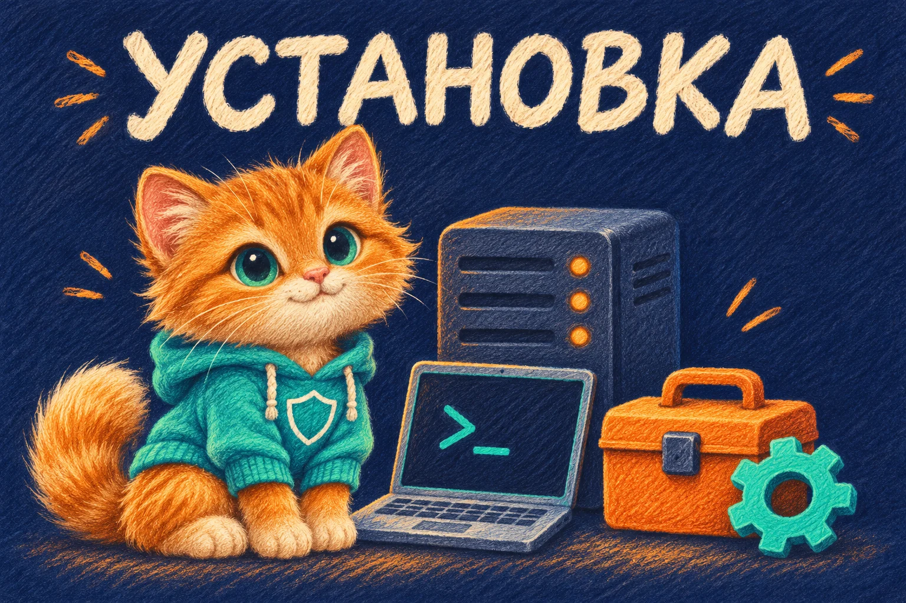

# Установка MTProxy Pushok одной командой

Инструкция для первой установки на отдельный VPS с Ubuntu 24.04 LTS. Она соответствует текущему мастеру `setup.sh` и проверкам ввода. Базовый сценарий ниже: классический MTProxy + кабинет + Telegram-бот + Mini App. Тестовый Telegram описан отдельно в [TELEGRAM_TEST_ENVIRONMENT.md](TELEGRAM_TEST_ENVIRONMENT.md).

<p align="center">
  <a href="https://github.com/mrkoster1988/mtproxy-pushok"></a>
</p>

## 1. Что подготовить

- Доступ к VPS по SSH под root. Если вошли обычным пользователем с sudo, сначала выполните `sudo -i`.
- Домен кабинета, например `ads.pushok.shop`, и адрес прокси, например `mtproxy.pushok.shop`. В DNS создайте A-записи на публичный IPv4 этого VPS. В поле кабинета нужен DNS-домен без схемы, пути, порта и IP; части до 63 символов, дефис не по краям. Регистр букв мастер нормализует. Не переносите основной `pushok.shop` с действующего сайта. Если AAAA задана, она тоже должна указывать на этот VPS с рабочим IPv6.
- Для нового Caddy свободны TCP 80/443; для прокси выбран свободный TCP 8443. Разрешите эти порты в используемом firewall VPS и у хостера. Существующие правила SSH сохраняйте.
- Токен именно бота MTProxy из @BotFather, имя без `@` (для вашего проекта — `mtproxy_pushok_bot`) и ваш числовой Telegram ID. ID не равен имени пользователя, телефону или ID бота. Мастер проверяет числовой диапазон ID и формат токена, но принадлежность токена/ID подтверждается только живой проверкой Telegram.
- Тег спонсора из @MTProxyBot, если уже получен: 32 hex-символа. Его можно добавить позднее.

Не передавайте токен в чат, командную строку, GitHub или скриншот. В мастере он вводится скрыто; при вводе символов не видно.

## 2. Одна команда

Вставьте в SSH-терминал под root целиком:

```bash
bash -c 'set -e; test "$(id -u)" -eq 0 || { echo "Сначала войдите как root: sudo -i"; exit 1; }; test ! -e /opt/mtproxy-pushok || { echo "Каталог /opt/mtproxy-pushok уже существует. Используйте раздел повторного запуска инструкции."; exit 1; }; apt-get update; apt-get install -y git ca-certificates python3 util-linux; git clone --branch main --single-branch https://github.com/mrkoster1988/mtproxy-pushok.git /opt/mtproxy-pushok; cd /opt/mtproxy-pushok; exec bash setup.sh'
```

Команда обновляет список пакетов, устанавливает Git, сертификаты, Python 3 и util-linux (flock), скачивает проект с GitHub в `/opt/mtproxy-pushok` и открывает мастер `setup.sh`. Она не требует заранее загружать install-файл на VPS. При наличии каталога останавливается, не удаляя его. Полное обновление Ubuntu и перезагрузка этой командой не выполняются.

Затем мастер, после вашего подтверждения, устанавливает необходимые компоненты: Docker/Compose для кабинета, PostgreSQL, API, бота, Caddy при выборе нового HTTPS; для классического MTProxy — компилятор, OpenSSL/zlib и systemd-службу. Пароли БД и внутренние секреты создаются автоматически. Отдельные драйверы не нужны.

При выборе существующего Docker нужен работающий Compose plugin; мастер не переустанавливает его автоматически при конфликте пакетов. Если загрузка GitHub недоступна, установка остановится — сервисы не будут объявлены запущенными.

### Полные ссылки на файлы установщика

- **Только классический MTProxy — install.sh:** [https://raw.githubusercontent.com/mrkoster1988/mtproxy-pushok/main/install.sh](https://raw.githubusercontent.com/mrkoster1988/mtproxy-pushok/main/install.sh).
- **Полный мастер — setup.sh:** [https://raw.githubusercontent.com/mrkoster1988/mtproxy-pushok/main/setup.sh](https://raw.githubusercontent.com/mrkoster1988/mtproxy-pushok/main/setup.sh). Для запуска ему нужен **весь репозиторий**, поэтому используйте команду клонирования выше.
- [Скачать весь проект ZIP](https://github.com/mrkoster1988/mtproxy-pushok/archive/refs/heads/main.zip) · [Посмотреть код install.sh](https://github.com/mrkoster1988/mtproxy-pushok/blob/main/install.sh).

Если требуется только отдельный прокси, полная команда скачивания и запуска:

```bash
curl --fail --location --show-error https://raw.githubusercontent.com/mrkoster1988/mtproxy-pushok/main/install.sh -o mtproxy-pushok-install.sh && sudo bash mtproxy-pushok-install.sh
```

Нужен `curl`; при его отсутствии на Ubuntu установите пакет `curl`. Скрипт запускается только после успешной загрузки. Кабинет, бота и Mini App эта команда не устанавливает. Команда `sudo bash install.sh` без скачивания работает только из каталога, где файл уже существует.

## 3. Готовые ответы: чистый VPS, обычный Telegram

`Enter` означает нажать клавишу без ввода текста. Замените домены на свои, если устанавливаете не под Pushok.

| № | Вопрос мастера | Ответ | Что получится |
|---|---|---|---|
| 1 | Что установить? | **3** | MTProxy и кабинет |
| 2 | Какой движок установить? | **3** | Автоматически: классический MTProxy |
| 3 | Назначение установки | **1** | Основная установка |
| 4 | Уникальное имя Compose-проекта | **Enter** | `mtproxy-pushok` |
| 5 | Как открыть кабинет? | **2** | Новый Caddy с HTTPS, нужны свободные 80/443 |
| 6 | Домен кабинета без схемы и пути | **ads.pushok.shop** | Например ваш отдельный поддомен; не вводите `https://` |
| 7 | Локальный порт API | **Enter** | `8000`, доступ только на localhost |
| 8 | Настроить Telegram-вход? | **1** | Настроить сейчас |
| 9 | Среда Telegram | **1** | Обычный Telegram |
| 10 | Токен бота из BotFather | **Ваш токен** | Ввод скрыт, без кавычек |
| 11 | Имя бота без @ | **mtproxy_pushok_bot** | Должно соответствовать токену |
| 12 | Назначить владельца кабинета? | **1** | Указать владельца сейчас |
| 13 | Числовой Telegram ID владельца | **Ваш числовой ID** | У этой учётной записи будет роль admin |
| 14 | Telegram Mini App | **1** | URL `https://ads.pushok.shop/miniapp` |
| 15 | Реквизиты для ручной оплаты | **2** | Настроить позже; вымышленные реквизиты не показываются |
| 16 | Начать установку пакетов и запуск сервисов? | **1** | Начать после просмотра итога |
| 17 | Домен или IPv4 MTProxy | **mtproxy.pushok.shop** | Либо публичный IPv4 VPS; должен быть доступен снаружи |
| 18 | Внешний TCP-порт | **Enter** | `8443` |
| 19 | Тег спонсора из @MTProxybot | **Ваш TAG или Enter** | Если тега пока нет — прокси запустится без спонсора |

После пункта 16 сначала устанавливается кабинет; вопросы 17–19 появятся при переходе к классическому MTProxy. Сборка и загрузка Docker-образов могут занять время. Если возникает ошибка, не продолжайте вслепую: сохраните её текст без секретов.

В этой основной конфигурации Stars и автоматическая СБП остаются выключенными до отдельной настройки и приёмки. Выбор Mini App не включает платежи. Цена RUB и цена XTR настраиваются независимо в тарифах кабинета. Если нужен ручной приём вместо ответа 2 в пункте 15, выберите 1 и введите реального получателя и инструкцию без суммы; поступление проверяет оператор.

### Если Nginx/Caddy уже установлен

В пункте 5 выберите **1** — существующий reverse proxy. Новый Caddy не запускается. Направьте отдельный HTTPS-домен кабинета на `127.0.0.1:8000`.

Для существующего Caddy, установленного на хосте:

```caddyfile
ads.pushok.shop {
    reverse_proxy 127.0.0.1:8000
}
```

Сначала проверьте конфигурацию, затем перезагрузите Caddy штатным способом. Если reverse proxy работает в другом Docker-контейнере, `127.0.0.1` внутри него — сам контейнер: маршрут к API нужно согласовать с существующей Docker-сетью, этот фрагмент туда вслепую не копируйте.

## 4. Что проверить после установки

Из каталога проекта под root:

```bash
cd /opt/mtproxy-pushok
docker compose --profile bot ps
curl -fsS http://127.0.0.1:8000/health/ready
systemctl is-active mtproxy-pushok.service
```

Далее:

1. Откройте `https://ads.pushok.shop`: сертификат должен быть действительным, не только локальная проверка API.
2. В @BotFather для того же бота выполните `/setdomain` и укажите домен кабинета. Вход кабинета — через Telegram. Откройте бота, нажмите `/start`, затем «Открыть Mini App»; должен появиться ваш кабинет.
3. Убедитесь, что ваш Telegram-пользователь имеет права владельца. Для проверки чужой заявки используйте вторую учётную запись, не администратора.
4. Для добавления рекламного канала назначьте бота администратором канала; рекламодатель также должен иметь права владельца/администратора. Пройдите заявку, модерацию и просмотр оплаты.
5. Используйте Telegram-ссылку прокси, которую напечатает классический установщик. Она содержит секрет доступа — не включайте её в общий диагностический вывод.
6. Если TAG отсутствовал, зарегистрируйте прокси через @MTProxyBot, получите тег и добавьте его через `sudo bash install.sh` из каталога проекта. Повторный запуск меняет конфигурацию/перезапускает существующий прокси. После изменения отдельно проверьте показ канала в независимом Telegram-клиенте.

«Контейнер запущен» не подтверждает живую доставку сообщений, оплату или спонсорский показ. Автоматическое переключение спонсоров ещё не завершено; ручное применение тега не считать автоматическим запуском кампании.

При проблеме готовности:

```bash
docker compose --profile bot logs --tail=50 api bot db
journalctl -u mtproxy-pushok.service -n 50 --no-pager
```

Перед отправкой журнала удалите токены, секреты, ссылки прокси и пользовательские данные. Проверка живого VPS, Stars/СБП и спонсорства остаётся обязательной до коммерческого запуска.

## 5. Пройти диалог без установки

Если проект уже скачан:

```bash
cd /opt/mtproxy-pushok
bash setup.sh --plan
```

На итоговый вопрос можно ответить **1**: с `--plan` пакеты и сервисы не устанавливаются. Вложенный классический установщик не запускается, поэтому вопросы домена/порта/TAG прокси (17–19) в этом режиме не появятся. Не вставляйте ответы с токеном через общую shell-команду или историю терминала.

## 6. Повторный запуск и обновление

Если каталог существует, повторно не клонируйте проект и не удаляйте `.env` или Docker-тома. Повторный запуск установленной версии:

```bash
cd /opt/mtproxy-pushok
bash setup.sh
```

Для изменения только кабинета выбирайте **2** в самом первом вопросе — это не запускает установщик прокси повторно. При найденной `.env` выберите **1**, чтобы сохранить настройки и обновить сервисы, либо **4** для запуска бота из сохранённых настроек. Вариант 4 требует уже сохранённых корректных токена, имени и внутреннего секрета.

Перед загрузкой новой версии сделайте резервную копию БД, `.env`, конфигурации прокси и приватных файлов по [STAGING.md](STAGING.md). Затем, если рабочая копия чистая:

```bash
cd /opt/mtproxy-pushok
git pull --ff-only origin main
bash setup.sh
```

Обновление сохраняет настройки Mini App/среды Telegram, а не задаёт их заново. Тестовую среду поднимайте отдельно, по специальной инструкции. Установленная версия проверяется командой `git rev-parse HEAD`.

## Предпусковая проверка после настройки

Под владельцем `.env` выполните `bash scripts/staging_preflight.sh`. Проверка не изменяет файлы и не запускает сервисы; она показывает ошибки конфигурации без значений секретов. [Режим без Docker, JSON-отчёт и готовые действия при ошибках](STAGING_PREFLIGHT.md).

После обновления мастер сохраняет PostgreSQL dump в приватный `.backups/`, затем применяет миграции одной транзакцией. [Что делать при ошибке, повторный запуск и границы резервной копии](INSTALL_RECOVERY.md). Для кабинета нужны Python 3 и `flock` (util-linux); они обычно есть в Ubuntu 24.04, мастер проверяет их наличие.
